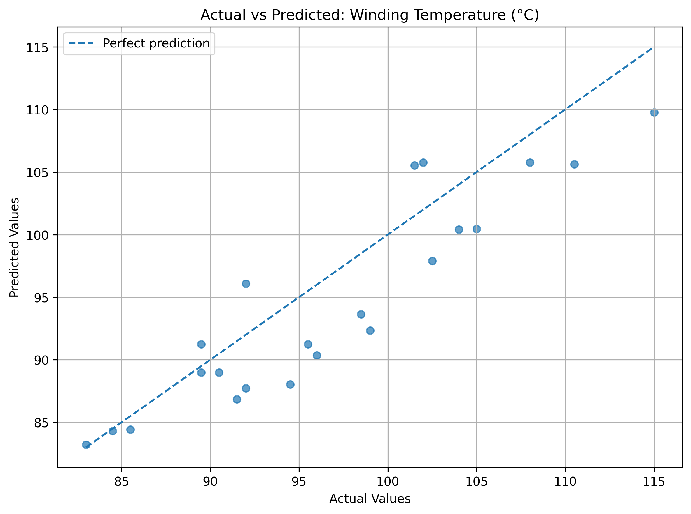
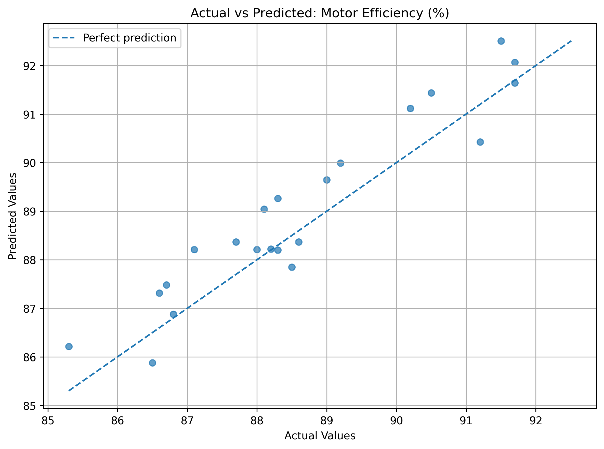
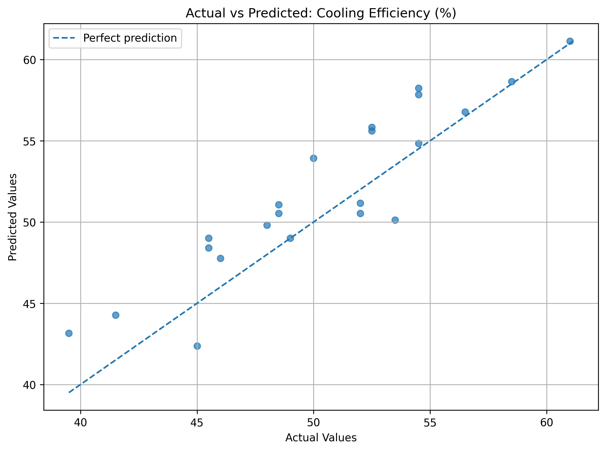
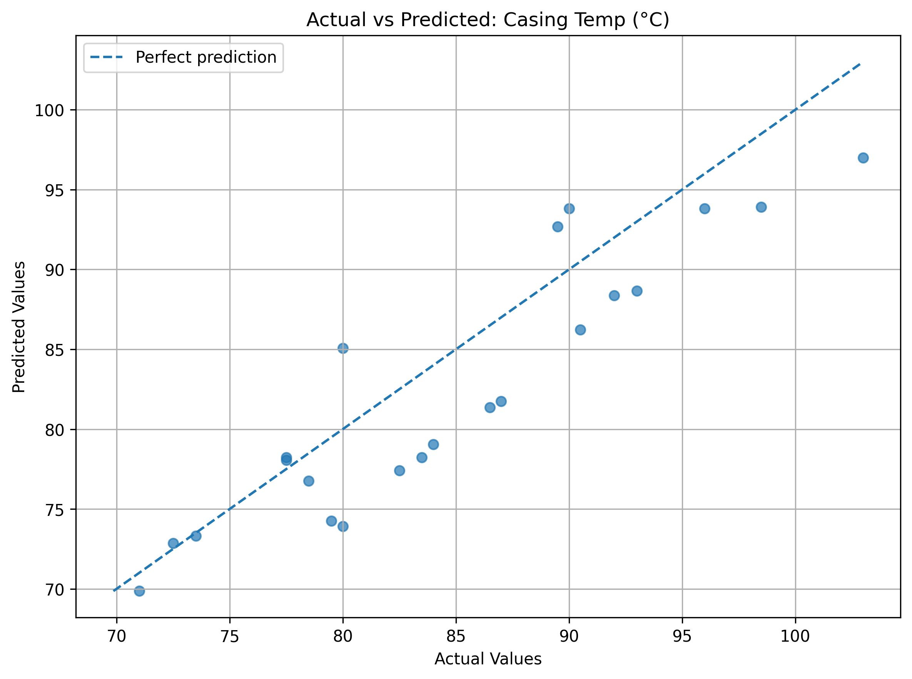
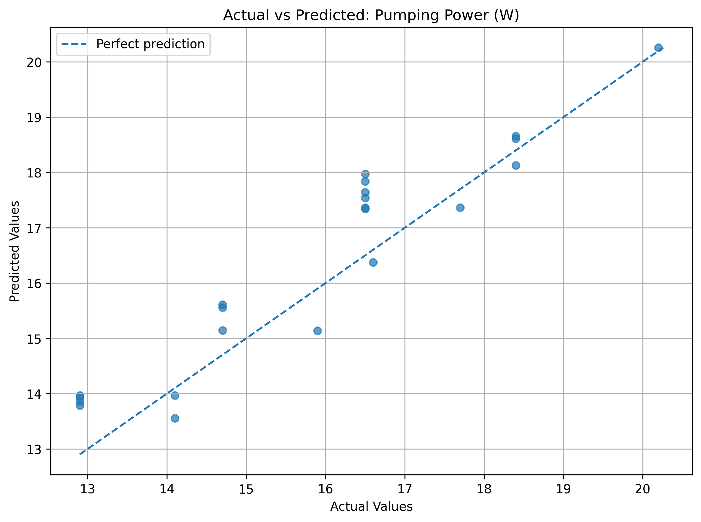

# 🚗 Artificial Neural Network-Based Prediction of Motor Cooling Performance

An Artificial Neural Network (ANN) model for predicting motor cooling performance using experimental data.

## 📌 Project Overview

This project uses an Artificial Neural Network to predict multiple motor performance parameters based on experimental operating conditions.

The dataset contains **108 experimental samples** and **10 columns**.

## 🎯 Objectives

- Analyze experimental motor-cooling data.
- Develop an ANN model to predict multiple performance parameters.
- Compare different ANN architectures.
- Evaluate model performance using regression metrics.
- Visualize actual and predicted values.
- Save the trained model and scalers for future predictions.

## 📊 Dataset

The dataset includes the following variables.
## 📊 Model Results

The ANN model predicts five motor-cooling performance parameters.
The following graphs compare the actual experimental values with
the values predicted by the model.

### Winding Temperature


### Motor Efficiency


### Cooling Efficiency


### Casing Temperature


### Pumping Power


### Input Features
- Coolant Flow Rate (LPH)
- Nanoparticle Concentration (%)
- Motor Speed (rpm)
- Motor Load (%)

### Prediction Targets
- Winding Temperature (°C)
- Motor Efficiency (%)
- Cooling Efficiency (%)
- Casing Temperature (°C)
- Pumping Power (W)

`Trial No.` is an identifier and is not a model input.

## 🧠 Model

The project uses a Multi-Layer Perceptron (MLP) Regressor from Scikit-learn.

The model uses:
- ReLU activation
- Adam optimizer
- StandardScaler for data scaling
- Multiple output variables

## 📈 Model Evaluation

Model performance is evaluated using:

- Mean Absolute Error (MAE)
- Mean Squared Error (MSE)
- Root Mean Squared Error (RMSE)
- R² Score

The project includes visualizations comparing actual and predicted values.

## 📁 Project Structure

```text
ann-motor-cooling-performance/
│
├── data/
│   ├── raw/
│   └── processed/
│
├── experiments/
│   ├── figures/
│   └── results/
│
├── models/
│   ├── best_ann_model.pkl
│   ├── input_scaler.pkl
│   ├── target_scaler.pkl
│   └── model_metadata.json
│
├── notebooks/
│   ├── 01_data_analysis.ipynb
│   ├── 02_ann_experiments.ipynb
│   └── 03_model_evaluation.ipynb
│
├── reports/
├── src/
└── .gitignore

## 🛠️ Technologies Used

- Python
- NumPy
- Pandas
- Matplotlib
- Scikit-learn
- Jupyter Notebook
- Git and GitHub

## 🚀 Future Work

- Test the model on additional experimental data.
- Improve prediction performance through further experimentation.
- Develop an interface for making predictions using new input values.

## 👩‍💻 Author

**Savinitha Sundararajan**  
B.Tech Artificial Intelligence  
SRM Institute of Science and Technology
